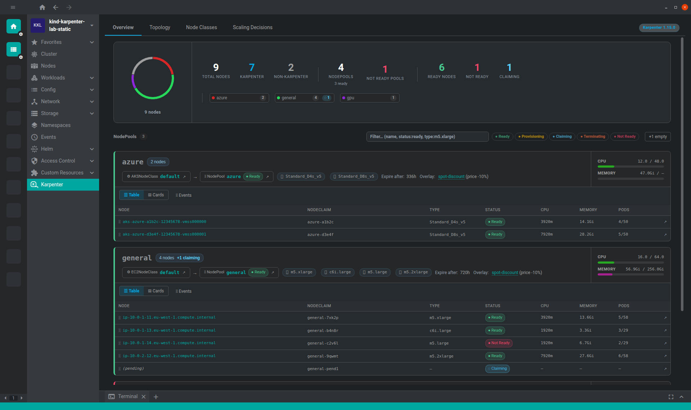
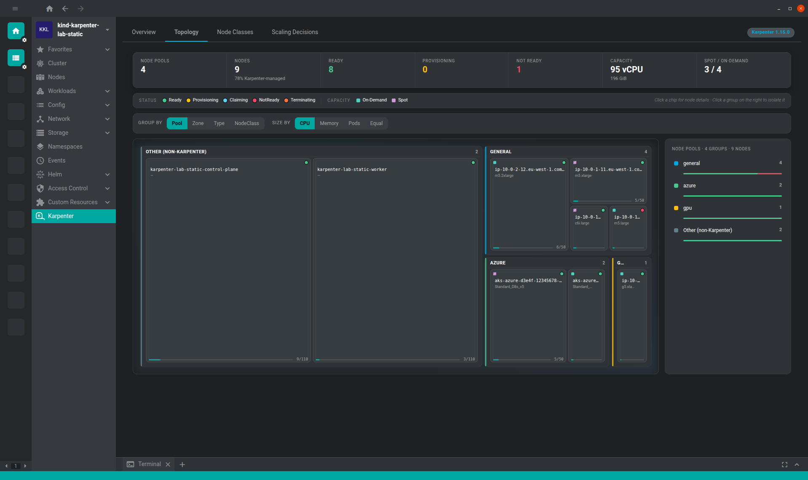
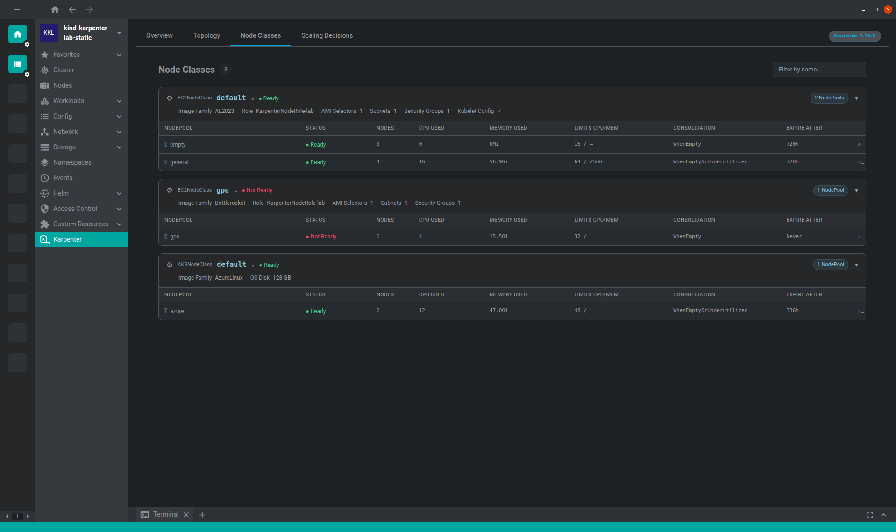
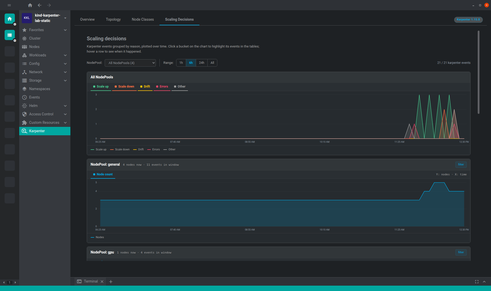
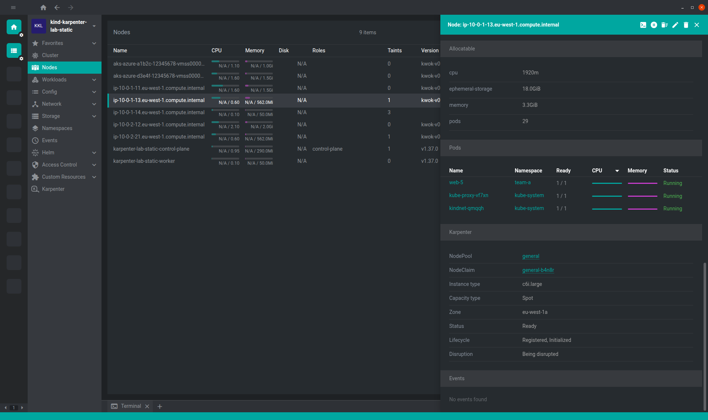

# @freelensapp/karpenter-extension

<!-- markdownlint-disable MD013 -->

[](https://freelens.app)
[](https://github.com/freelensapp/freelens-karpenter-extension)
[](https://github.com/freelensapp/freelens-karpenter-extension/releases)
[](https://github.com/freelensapp/freelens-karpenter-extension/actions/workflows/integration-tests.yaml)
[](https://www.npmjs.com/package/@freelensapp/karpenter-extension)

<!-- markdownlint-enable MD013 -->

[Freelens](https://freelens.app) extension for [Karpenter](https://karpenter.sh/),
the open source node autoscaler that launches and removes the nodes of a
Kubernetes cluster to fit its pods. A visual interface to watch what Karpenter
does to your nodes, on AWS, Azure and GCP: the extension reads the Karpenter
objects, the nodes, the pods and the events of the cluster, and writes nothing
to it.

[Video Demo](https://github.com/user-attachments/assets/c0fda200-c32e-4580-be34-59087b05343f)

## Authors

- [Alberto Lunghi](https://github.com/albyrex) created the first version of
  this extension and, in 2.3.0, added the usage of the nodes to the cards of
  the Overview.
- [Roberto Bandini](https://github.com/robertobandini) helped him complete the
  first version and ported the extension to the extension API of Freelens 2.
- [Piotr Roszatycki](https://github.com/dex4er) added the support for Karpenter
  on GCP and the pages of every kind, and maintains the extension.

## What it shows

The extension adds **Karpenter** to the cluster sidebar, with its pages as
entries: **Overview**, a dashboard with four tabs, **Node Claims**, **Node
Pools**, **Node Overlays** and, on AWS, **EC2 Node Classes**, on Azure,
**AKS Node Classes** or, on GCP, **GCE Node Classes** and **GCE Custom Machine
Types**, the lists of the NodeClaims, the NodePools, the NodeOverlays, the node
classes and the custom machine types with their details. It also adds a Karpenter section to the details of a node. It follows the Freelens theme, light or dark, and
updates while it is open, as Karpenter launches and removes nodes.

### Overview



- Total, Karpenter-managed and other nodes, NodePools and their readiness,
  nodes by status, NodeClaims still waiting for a node.
- One card per NodePool: its node class, status, instance types, limits and
  usage of CPU and memory, `expireAfter`, the NodeOverlays that apply to it
  and, apart, those that Karpenter rejected, its nodes as a table or as cards,
  and its recent events.
- A filter by name, by node status (`status:ready`), by instance type
  (`type:m5.large`) and by NodePool status (`poolstatus:notready`).
  NodePools without nodes are behind "+N empty".

### Topology



A treemap of the nodes, grouped by NodePool, zone, instance type or node
class, sized by CPU, memory, pods or equally, with each node's status and
capacity type (spot or on-demand). A click on a node opens its details.

### Node Classes



Every EC2NodeClass (AWS), AKSNodeClass (Azure) and GCENodeClass (GCP) with
its status and main settings (image family, role or service account,
selectors, disks, subnet ranges, kubelet settings, OS disk), and the NodePools that use it,
with their nodes, usage, limits, consolidation and expiry. The tab reads only
the node classes of the provider the cluster runs, so a GKE cluster shows
nothing of AWS or Azure, and the reverse.

### Scaling Decisions



Karpenter's events over time, grouped as scale up, scale down, drift, errors
and other, for the last hour, 6 hours, 24 hours or all; the number of nodes of
each NodePool over time; and the pod and node decisions as tables. A click on
a time bucket highlights its events in the tables.

### Node Claims

The NodeClaims with the columns Type, Capacity, Zone, Node, NodePool,
NodeClass, Status, Drifted and Age, sortable, searchable, and with the columns
you choose. Status is Ready, Provisioning, Claiming, Terminating or Not Ready,
in the colours of the Overview. A NodeClaim still waiting for its node is
Claiming and has no Node. The node, the NodePool and the node class are links.
The entry is in the sidebar while the cluster serves NodeClaims.

A click on a NodeClaim, here or in the tabs, opens its details: why it is not
ready, the first of launched, registered and initialized it has not reached
and why, also when its launch failed, whether it drifted, its node, NodePool
and node class as links, its instance type, capacity type, zone, provider ID
and image ID, the time of its last pod event, the capacity and allocatable of
its node, and its spec: resource requests, requirements, taints, startup
taints, expiry and termination grace period. Freelens shows its conditions
and events with them.

### Node Pools

The NodePools with the columns of `kubectl get nodepools -o wide`: NodeClass,
Nodes, Weight, CPU, Memory, Ready and Age, sortable, searchable, and with the
columns you choose. A NodePool without a weight has 0, as Karpenter takes it.
Memory is in units, such as 15.5GiB, as Freelens shows the memory of a node,
here and in the details. The entry is in the sidebar while the cluster serves
NodePools.

A click on a NodePool, here or in the tabs, opens its details: why it is not
ready, its node class, weight, replicas and nodes, the resources in use
against its limits, the template of its NodeClaims (labels, annotations,
requirements, taints, startup taints, expiry and termination grace period),
its disruption settings and budgets, and its NodeClaims with their nodes and
the NodeOverlays that apply to it, as links, with those that Karpenter
rejected and why.
Freelens shows its conditions and events with them.

### Node Overlays

The NodeOverlays with the columns of `kubectl get nodeoverlays -o wide`:
Weight, Ready and Age, sortable, searchable, and with the columns you choose.
A NodeOverlay without a weight has 0, as Karpenter takes it. The entry is in
the sidebar while the cluster serves NodeOverlays.

A click on a NodeOverlay, here or on a NodePool card, opens its details: why
it is not ready, and why Karpenter has not validated it, such as a conflict
with another overlay of the same weight, its weight, requirements, price or
price adjustment, and the capacity it adds, and the NodePools it applies to,
as links. Freelens shows its conditions and events with them.

### EC2 Node Classes

The EC2NodeClasses with the columns of `kubectl get ec2nodeclasses -o wide`:
Role, Ready and Age, sortable, searchable, and with the columns you choose.
The entry is in the sidebar while the cluster serves EC2NodeClasses, which
only Karpenter on AWS does.

A click on an EC2NodeClass, here, in the Node Classes tab, on a NodePool card
or in the NodeClass column of the Node Pools and Node Claims pages, opens its
details: why it is not ready or not validated; the selector terms of its AMIs,
subnets, security groups, capacity reservations and placement group, each next
to what Karpenter resolved them to and to why they did not resolve, with the
state and end time of a capacity block; its role and its instance profile; its
block device mappings and instance store policy, network interfaces,
connection tracking, public IP address and IP prefix count, metadata, enclave
and CPU options, detailed monitoring, kubelet settings, tags and context; its
user data, collapsed; and the NodePools that use it, as links. Freelens shows
its conditions and events with them.

### AKS Node Classes

The AKSNodeClasses with the columns of `kubectl get aksnodeclasses -o wide`:
ImageFamily, Ready and Age, sortable, searchable, and with the columns you
choose. The entry is in the sidebar while the cluster serves AKSNodeClasses,
which only Karpenter on Azure does; the page reads `v1beta1`, or `v1alpha2` on
a provider older than 1.14.3.

A click on an AKSNodeClass, here, in the Node Classes tab, on a NodePool card
or in the NodeClass column of the Node Pools and Node Claims pages, opens its
details: why it is not ready or not validated; its image family, FIPS mode and
the images it resolved; the Kubernetes version it uses, the versions pinned in
its spec and those Karpenter observed; its VNet subnet and node public IP; its
local DNS mode, overrides and resolved state; its capacity reservation group
with the reservations it resolved to; each with why it is not ready; the OS
disk, max pods, workload runtime, security, GPU, artifact streaming, kubelet,
Linux OS config and tags of its nodes; and the NodePools that use it, as
links. Freelens shows its conditions and events with them.

### GCE Node Classes

The GCENodeClasses with the columns of `kubectl get gcenodeclasses -o wide`,
Ready and Age, after Image Family, Disks and Subnet. Image Family has a
`family=version` badge for each image selector term with a family, its
channel when it names no version, such as `ContainerOptimizedOS=stable`, and
`latest` without either, or the image family of a node class without terms;
Disks has a badge for each disk, such as `boot 100 GiB pd-balanced`; Subnet has
the pod ranges the node class names, `subnetRangeNames` or the deprecated
`subnetRangeName`, a badge each when there are several. They are sortable,
searchable, and with the columns you choose. The entry is in the sidebar while
the cluster serves GCENodeClasses, which only Karpenter on GCP does.

A click on a GCENodeClass, here, in the Node Classes tab, on a NodePool card
or in the NodeClass column of the Node Pools and Node Claims pages, opens its
details: why it is not ready; its image family and image selector terms next
to the images they resolved to, with why they did not; the service account,
disks, local SSD mode, shielded and confidential instance settings, advanced
machine features, Spot preemption notice, hugepages, kubelet configuration,
labels and metadata of its instances; its subnetwork, subnet ranges with the
free IPs of each, private nodes, additional network interfaces and network
tags; its GPU driver version and automatic GPU taint; and the NodePools that
use it, as links. Freelens shows its conditions and events with them.

### GCE Custom Machine Types

The GCECustomMachineTypes with the columns of
`kubectl get gcecustommachinetypes -o wide`: Machine Type, Ready and Age,
sortable, searchable, and with the columns you choose. The entry is in the
sidebar while the cluster serves GCECustomMachineTypes, which Karpenter on GCP
does since 0.7.

A click on a GCECustomMachineType opens its details: why it is not ready, its
machine type, such as `n2-custom-8-24576`, its on-demand and spot prices in
USD per hour, which GCP does not publish for custom shapes, and the vCPUs,
memory and zones the provider resolved for it. Freelens shows its conditions
and events with them.

While the extension is enabled, NodePools, NodeClaims, NodeOverlays,
EC2NodeClasses, AKSNodeClasses, GCENodeClasses and GCECustomMachineTypes are no
longer listed under Custom Resources in the sidebar: each has its page here.

### Node details



The details of a node that Karpenter manages show its NodePool and NodeClaim
(with links), instance and capacity type, zone, status, whether it is
registered and initialized, and whether Karpenter is disrupting it or must not.

## Requirements

- Freelens 2.0.0 or a later 2.x (extension API v2). Freelens 1.x needs a 1.x
  version of the extension, which is no longer maintained.
- Karpenter v1 (`karpenter.sh/v1`), on AWS EKS, Azure AKS (node
  autoprovisioning) or Google GKE (the
  [GCP provider](https://github.com/cloudpilot-ai/karpenter-provider-gcp) of
  CloudPilot AI). The extension follows Karpenter 1.15, the AWS provider 1.15,
  the Azure provider 1.14 and the GCP provider 0.7.

## Supported APIs

| Group                 | API Version       | Kind                   | Shown in                                           |
| --------------------- | ----------------- | ---------------------- | -------------------------------------------------- |
| `karpenter.sh`        | v1                | `NodePool`             | every tab, Node Pools                              |
| `karpenter.sh`        | v1                | `NodeClaim`            | Overview, Topology, Scaling Decisions, Node Claims |
| `karpenter.sh`        | v1alpha1          | `NodeOverlay`          | Overview (NodePool cards), Node Overlays           |
| `karpenter.k8s.aws`   | v1                | `EC2NodeClass`         | Overview, Node Classes, EC2 Node Classes           |
| `karpenter.azure.com` | v1beta1, v1alpha2 | `AKSNodeClass`         | Overview, Node Classes, AKS Node Classes           |
| `karpenter.k8s.gcp`   | v1alpha1          | `GCENodeClass`         | Overview, Node Classes, GCE Node Classes           |
| `karpenter.k8s.gcp`   | v1alpha1          | `GCECustomMachineType` | GCE Custom Machine Types                           |

A kind that the cluster does not serve is left out; the Overview says so when the
cluster has no NodePool CRD.

## Permissions

The extension only reads the cluster. It lists and watches the kinds above,
nodes, pods, and the events of the namespaces `default`, `karpenter` and
`karpenter-system`, and lists the CRDs and namespaces. For the version of the
controller it lists the Deployments labelled `app.kubernetes.io/name=karpenter`
in all namespaces, or, if that is not allowed, the Deployments of `karpenter`
and `karpenter-system`.

## Install

Open Freelens and go to Extensions (`ctrl`+`shift`+`E` or
`cmd`+`shift`+`E`). The field at the top takes a package name, the URL of a
tarball, or the path to a tarball or a directory.

### From the registry

Enter `@freelensapp/karpenter-extension` and press Install.

Alternatively, open the following URL in the browser to install directly:

[freelens://app/extensions/install/%40freelensapp%2Fkarpenter-extension](freelens://app/extensions/install/%40freelensapp%2Fkarpenter-extension)

### From a release tarball

Each [release](https://github.com/freelensapp/freelens-karpenter-extension/releases)
has the extension as `freelensapp-karpenter-extension-<version>.tgz`, with its
checksum in `freelensapp-karpenter-extension-<version>.tgz.sha256`. Use a
release whose major version matches your Freelens version.

- Enter the URL of the `.tgz` asset and press Install. Freelens downloads the
  `.tgz.sha256` next to it and checks the tarball against it.
- Or download both files into one directory and enter the path to the `.tgz`,
  or drop the `.tgz` on the Freelens window. Freelens checks it against the
  `.tgz.sha256` next to it.

### From a directory

Build the extension (see below), then enter the path to your checkout, the
directory with `package.json`, and press Install. Freelens runs the extension
from that directory, from the files in `dist/`, and lists it as unverified.
This is how you work on the extension: see
[Development loop](#development-loop).

## Build from the source

### Prerequisites

Use [NVM](https://github.com/nvm-sh/nvm),
[mise-en-place](https://mise.jdx.dev/), or
[windows-nvm](https://github.com/coreybutler/nvm-windows) to install the
Node.js version in `.nvmrc`.

From the root of this repository:

```sh
nvm install
# or
mise install
# or
winget install CoreyButler.NVMforWindows
nvm install "$(cat .nvmrc)"
nvm use "$(cat .nvmrc)"
```

Install pnpm:

```sh
corepack install
# or
curl -fsSL https://get.pnpm.io/install.sh | sh -
# or
winget install pnpm.pnpm
```

### Build extension

```sh
pnpm install
pnpm build
```

The extension is built into `dist/`. To pack it into a tarball:

```sh
pnpm pack
```

One script to bump the prerelease version, build and pack the extension for
testing:

```sh
pnpm pack:dev
```

The tarball is placed in the current directory. Install it as described in
[From a release tarball](#from-a-release-tarball).

### Development loop

Install the extension from your checkout once, as described in
[From a directory](#from-a-directory), then run:

```sh
pnpm dev
```

It rebuilds the extension whenever a source file changes, and Freelens
reloads the extension after each rebuild, without a restart and without
packing. Stop it with `ctrl`+`C`.

Neither `pnpm build` nor `pnpm dev` type-checks; run `pnpm type:check` for
that. A change to `main` or `renderer` in `package.json` needs Freelens
restarted once.

To check the extension in Freelens with an AI agent, see "Checking the
Extension in Freelens" in [AGENTS.md](AGENTS.md).

### Karpenter objects on a kind cluster

The fixtures of the integration tests give a [kind](https://kind.sigs.k8s.io/)
cluster the CRDs and objects of one Karpenter variant, `aws`, `aks` or `gcp`, without
a controller, so you can work on the extension without a cloud account:

```sh
kubectl --context kind-kind apply --server-side -k integration/fixtures/aws/crds
kubectl --context kind-kind wait --for=condition=Established crd --all
kubectl --context kind-kind apply --server-side -f integration/fixtures/aws/objects.yaml
kubectl --context kind-kind apply --server-side --subresource=status -f integration/fixtures/aws/status.yaml
```

Remove them with `kubectl delete -f` of `objects.yaml` and `kubectl delete -k`
of `crds`, before you apply another variant.

### Check the code

```sh
pnpm type:check
pnpm test:unit
pnpm lint:check
pnpm knip:check
```

and, for the formats that Biome does not cover:

```sh
pnpm trunk:check
```

### Integration tests

The integration tests drive Freelens dev, started from a
[freelensapp/freelens](https://github.com/freelensapp/freelens) checkout,
against a kind cluster. In the Freelens checkout:

```sh
pnpm dev
```

Freelens dev lists no cluster until a kubeconfig is added in Preferences >
Kubernetes > Kubeconfig Syncs. Add one with the kind cluster, for example:

```sh
kubectl config view --minify --flatten --context kind-kind > ~/kind-kind.kubeconfig
```

Then, with the kind cluster running, in the extension repository:

```sh
pnpm build
pnpm test:integration
```

The tests install the checkout in place, replacing any other installation of
the extension in Freelens dev. They delete every Karpenter CRD on the kind
cluster, and with it every Karpenter object, so use a kind cluster with
nothing worth keeping. Without Freelens dev or the cluster the tests are
skipped.

Optional variables:

- `TEST_KIND_CLUSTER_NAME`: the kind cluster, `kind` by default, used
  through the context `kind-<name>`.
- `FREELENS_CDP_URL`: the CDP endpoint of Freelens dev,
  `http://127.0.0.1:9223` by default.
- `FREELENS_MAIN_LOG`: a log of the main process to check for errors, such
  as its `lens.log`. Without it only the renderer's errors are checked.

## License

Copyright (c) 2025-2026 Freelens Authors.

[MIT License](https://opensource.org/licenses/MIT)
