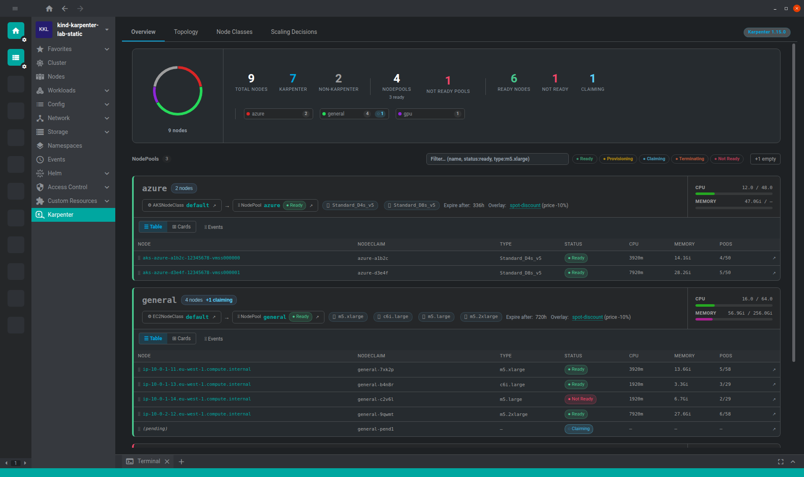
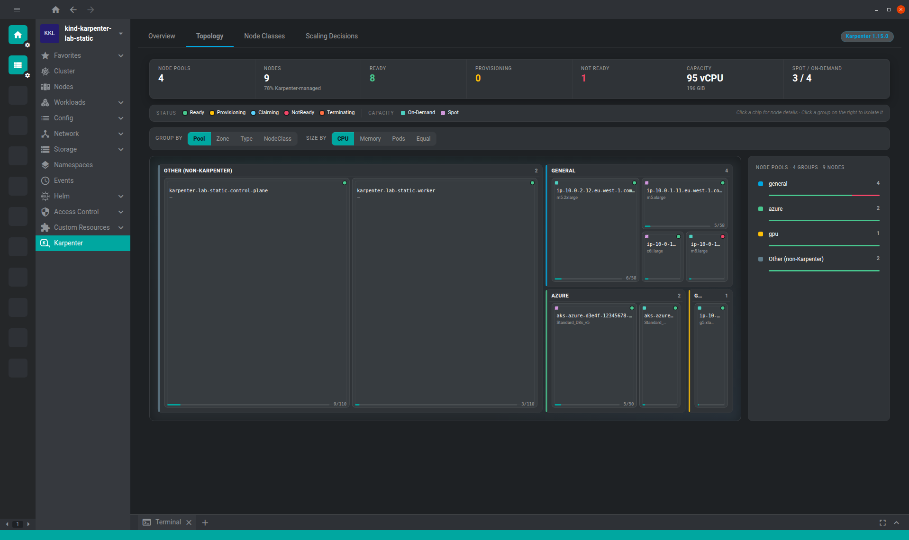
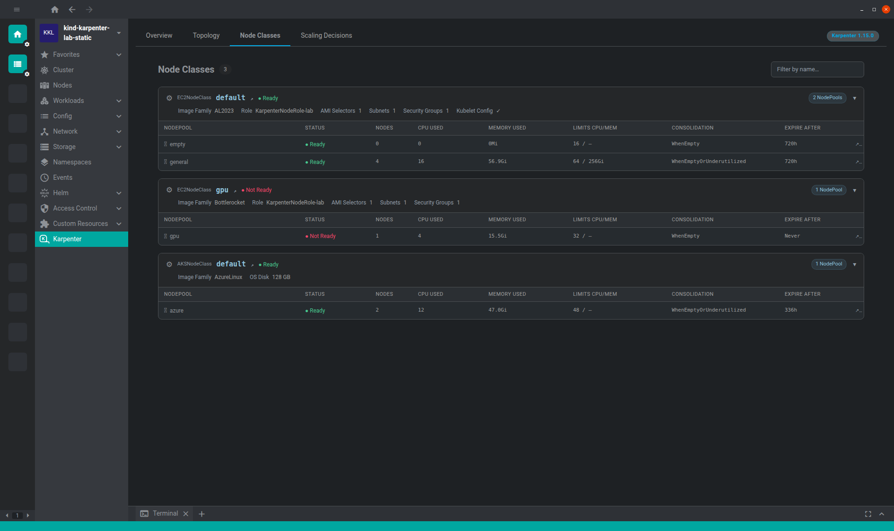
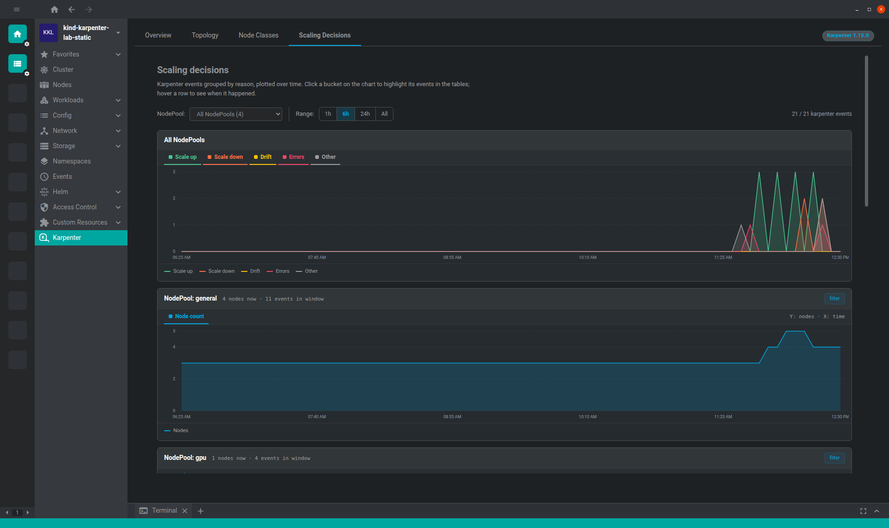
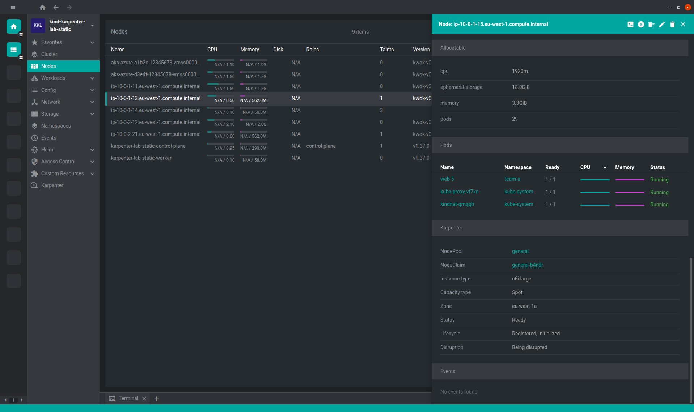

# Freelens Karpenter Extension

[Freelens](https://freelens.app) extension for [Karpenter](https://karpenter.sh/).

A visual interface to monitor Karpenter's resources and the actions it performs.

Born from an idea by Roberto Bandini [@robertobandini](https://github.com/robertobandini) and Alberto Lunghi [@albyrex](https://github.com/albyrex), who created the first version.

## What it shows

The extension adds a **Karpenter** page to the cluster sidebar, with four
tabs, and a Karpenter section to the details of a node. It follows the
Freelens theme, light or dark, and updates while it is open, as Karpenter
launches and removes nodes.

### Overview



- Total, Karpenter-managed and other nodes, NodePools and their readiness,
  nodes by status, NodeClaims still waiting for a node.
- One card per NodePool: its node class, status, instance types, limits and
  usage of CPU and memory, `expireAfter`, the NodeOverlays that can apply to
  it, its nodes as a table or as cards, and its recent events.
- A filter by name, by node status (`status:ready`), by instance type
  (`type:m5.large`) and by NodePool status (`poolstatus:notready`).
  NodePools without nodes are behind "+N empty".

### Topology



A treemap of the nodes, grouped by NodePool, zone, instance type or node
class, sized by CPU, memory, pods or equally, with each node's status and
capacity type (spot or on-demand). A click on a node opens its details.

### Node Classes



Every EC2NodeClass (AWS) and AKSNodeClass (Azure) with its status and main
settings (image family, role, selectors, kubelet settings, OS disk), and the
NodePools that use it, with their nodes, usage, limits, consolidation and
expiry.

### Scaling Decisions



Karpenter's events over time, grouped as scale up, scale down, drift, errors
and other, for the last hour, 6 hours, 24 hours or all; the number of nodes of
each NodePool over time; and the pod and node decisions as tables. A click on
a time bucket highlights its events in the tables.

### Node details



The details of a node that Karpenter manages show its NodePool and NodeClaim
(with links), instance and capacity type, zone, status, whether it is
registered and initialized, and whether Karpenter is disrupting it or must not.

## Requirements

- Freelens >= 2.0.0. The 1.x versions of the extension are for Freelens 1.x
  and are no longer maintained.
- Karpenter v1 (`karpenter.sh/v1`), on AWS EKS or Azure AKS (node
  autoprovisioning). The extension follows Karpenter 1.15, the AWS provider
  1.15 and the Azure provider 1.14.

## Supported APIs

| Group                 | API Version       | Kind           | Shown in                              |
| --------------------- | ----------------- | -------------- | ------------------------------------- |
| `karpenter.sh`        | v1                | `NodePool`     | every tab                             |
| `karpenter.sh`        | v1                | `NodeClaim`    | Overview, Topology, Scaling Decisions |
| `karpenter.sh`        | v1alpha1          | `NodeOverlay`  | Overview (NodePool cards)             |
| `karpenter.k8s.aws`   | v1                | `EC2NodeClass` | Overview, Node Classes                |
| `karpenter.azure.com` | v1beta1, v1alpha2 | `AKSNodeClass` | Overview, Node Classes                |


A kind that the cluster does not serve is left out; the page says so when the
cluster has no NodePool CRD.

## Permissions

The extension only reads the cluster. It lists and watches the kinds above,
nodes, pods, and the events of the namespaces `default`, `karpenter` and
`karpenter-system`, and lists the CRDs and namespaces. For the version of the
controller it lists the Deployments labelled `app.kubernetes.io/name=karpenter`
in all namespaces, or, if that is not allowed, the Deployments of `karpenter`
and `karpenter-system`.

## Install

Open Freelens and go to Extensions (`ctrl`+`shift`+`E` or
`cmd`+`shift`+`E`). The field at the top takes a package name, the URL of a
tarball, or the path to a tarball or a directory.

### From the registry

Enter `@freelensapp/karpenter-extension` and press Install.

Alternatively, open the following URL in the browser to install directly:

[freelens://app/extensions/install/%40freelensapp%2Fkarpenter-extension](freelens://app/extensions/install/%40freelensapp%2Fkarpenter-extension)

### From a release tarball

Each [release](https://github.com/freelensapp/freelens-karpenter-extension/releases)
has the extension as `freelensapp-karpenter-extension-<version>.tgz`, with its
checksum in `freelensapp-karpenter-extension-<version>.tgz.sha256`. Use a
release whose major version matches your Freelens version.

- Enter the URL of the `.tgz` asset and press Install. Freelens downloads the
  `.tgz.sha256` next to it and checks the tarball against it.
- Or download both files into one directory and enter the path to the `.tgz`,
  or drop the `.tgz` on the Freelens window. Freelens checks it against the
  `.tgz.sha256` next to it.

### From a directory

Build the extension (see below), then enter the path to your checkout, the
directory with `package.json`, and press Install. Freelens runs the extension
from that directory, from the files in `dist/`, and lists it as unverified.
This is how you work on the extension: see
[Development loop](#development-loop).

## Build from the source

### Prerequisites

Use [NVM](https://github.com/nvm-sh/nvm),
[mise-en-place](https://mise.jdx.dev/), or
[windows-nvm](https://github.com/coreybutler/nvm-windows) to install the
Node.js version in `.nvmrc`.

From the root of this repository:

```sh
nvm install
# or
mise install
# or
winget install CoreyButler.NVMforWindows
nvm install "$(cat .nvmrc)"
nvm use "$(cat .nvmrc)"
```

Install pnpm:

```sh
corepack install
# or
curl -fsSL https://get.pnpm.io/install.sh | sh -
# or
winget install pnpm.pnpm
```

### Build extension

```sh
pnpm install
pnpm build
```

The extension is built into `dist/`. To pack it into a tarball:

```sh
pnpm pack
```

One script to bump the prerelease version, build and pack the extension for
testing:

```sh
pnpm pack:dev
```

The tarball is placed in the current directory. Install it as described in
[From a release tarball](#from-a-release-tarball).

### Development loop

Install the extension from your checkout once, as described in
[From a directory](#from-a-directory), then run:

```sh
pnpm dev
```

It rebuilds the extension whenever a source file changes, and Freelens
reloads the extension after each rebuild, without a restart and without
packing: a few seconds after you save. A reload takes the extension down and
up again, so an open Karpenter page closes; open it again from the sidebar.
Stop `pnpm dev` with `ctrl`+`C`.

Neither `pnpm build` nor `pnpm dev` type-checks; run `pnpm type:check` for
that. A change to `main` or `renderer` in `package.json` needs Freelens
restarted once.

To check the extension in Freelens with an AI agent, see "Checking the
Extension in Freelens" in [AGENTS.md](AGENTS.md).

### Karpenter objects on a kind cluster

The fixtures of the integration tests give a [kind](https://kind.sigs.k8s.io/)
cluster the CRDs and objects of one Karpenter variant, `aws` or `aks`, without
a controller, so you can work on the extension without a cloud account:

```sh
kubectl --context kind-kind apply --server-side -k integration/fixtures/aws/crds
kubectl --context kind-kind wait --for=condition=Established crd --all
kubectl --context kind-kind apply --server-side -f integration/fixtures/aws/objects.yaml
kubectl --context kind-kind apply --server-side --subresource=status -f integration/fixtures/aws/status.yaml
```

Remove them with `kubectl delete -f` of `objects.yaml` and `kubectl delete -k`
of `crds`, before you apply another variant.

### Check the code

```sh
pnpm type:check
pnpm test:unit
pnpm lint:check
pnpm knip:check
```

and, for the formats that Biome does not cover:

```sh
pnpm trunk:check
```

### Integration tests

The integration tests drive Freelens dev, started from a
[freelensapp/freelens](https://github.com/freelensapp/freelens) checkout,
against a kind cluster. In the Freelens checkout:

```sh
pnpm dev
```

Freelens dev lists no cluster until a kubeconfig is added in Preferences >
Kubernetes > Kubeconfig Syncs. Add one with the kind cluster, for example:

```sh
kubectl config view --minify --flatten --context kind-kind > ~/kind-kind.kubeconfig
```

Then, with the kind cluster running, in the extension repository:

```sh
pnpm build
pnpm test:integration
```

The tests install the checkout in place, replacing any other installation of
the extension in Freelens dev. They delete every Karpenter CRD on the kind
cluster, and with it every Karpenter object, so use a kind cluster with
nothing worth keeping. Without Freelens dev or the cluster the tests are
skipped.

Optional variables:

- `TEST_KIND_CLUSTER_NAME`: the kind cluster, `kind` by default, used
  through the context `kind-<name>`.
- `FREELENS_CDP_URL`: the CDP endpoint of Freelens dev,
  `http://127.0.0.1:9223` by default.
- `FREELENS_MAIN_LOG`: a log of the main process to check for errors. Without
  it only the renderer's errors are checked.

### Testing the extension with unpublished Freelens

In the Freelens working repository:

```sh
rm -f *.tgz
pnpm i
pnpm build
pnpm pack -r
```

Then in the extension repository:

```sh
echo "overrides:" >> pnpm-workspace.yaml
for i in ../freelens/*.tgz; do
  name=$(tar zxOf $i package/package.json | yq -r .name)
  echo "  \"$name\": $i" >> pnpm-workspace.yaml
done

pnpm clean:node_modules
pnpm build
```

## License

Copyright (c) 2025-2026 Freelens Authors.

[MIT License](https://opensource.org/licenses/MIT)
